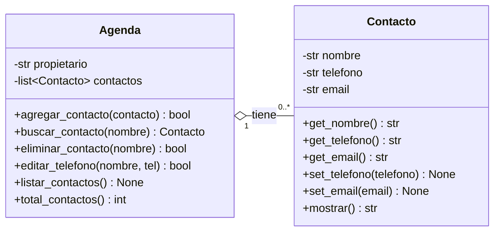

# Diagrama UML – Agenda y Contacto

## Leyenda

| Símbolo | Significado |
|---------|-------------|
| `-` | Atributo/método privado |
| `+` | Atributo/método público |
| `o--` | Agregación: la Agenda tiene Contactos |
| `1` / `0..*` | Una agenda tiene cero o muchos contactos |